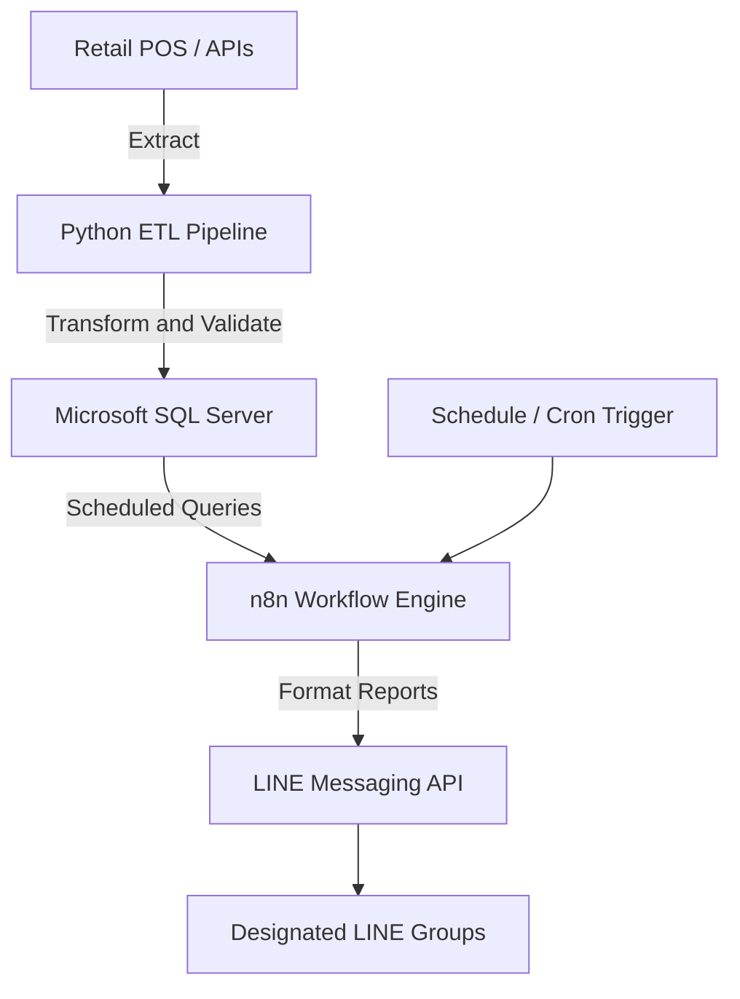

# Multi-Store Sales Reporting & Automation Pipeline

An automated, end-to-end ETL pipeline for collecting, processing, and reporting daily sales performance across multiple retail stores.

Built with **Python, Microsoft SQL Server, n8n, and the LINE Messaging API**, this project centralizes sales data and automates scheduled report delivery, reducing manual reporting effort and improving operational visibility.

## Table of Contents

- [Overview](#overview)
- [System Architecture](#system-architecture)
- [Key Features](#key-features)
- [Technology Stack](#technology-stack)
- [Repository Structure](#repository-structure)
- [Getting Started](#getting-started)
- [Configuration](#configuration)
- [Running the ETL Pipeline](#running-the-etl-pipeline)
- [n8n Workflow Setup](#n8n-workflow-setup)
- [Security Best Practices](#security-best-practices)
- [License](#license)

## Overview

This project automates the daily sales reporting workflow for multi-store retail operations, from raw data extraction to scheduled report distribution.

The pipeline integrates retail sales data sources with a centralized SQL Server database. Python scripts handle data extraction and transformation, while n8n orchestrates scheduled queries and report delivery through LINE.

### Reporting Workflow

- **Data extraction:** Retrieve sales records, transaction data, and item-level sales details from supported retail systems and APIs.
- **Data transformation:** Clean, normalize, validate, and aggregate extracted data.
- **Data storage:** Load and maintain reporting data in Microsoft SQL Server.
- **Workflow orchestration:** Use n8n to execute scheduled database queries and format report payloads.
- **Automated distribution:** Deliver daily sales summaries to designated LINE chat groups.

The workflow is designed to support centralized reporting across multiple store locations and scheduled reporting periods.

## System Architecture



### Reporting Schedule

The intended reporting schedule supports three daily reporting periods:

| Schedule | Purpose |
|---|---|
| 16:00 | Afternoon sales update |
| 20:00 | Evening sales update |
| 23:00 | End-of-day sales summary |

*Reporting times are configurable through the n8n workflow. Actual execution depends on the configured schedule and server time zone.*

## Key Features

- **Multi-store data integration** — Consolidate sales data from multiple store locations.
- **Automated ETL processing** — Extract, transform, validate, and load reporting data using Python.
- **Centralized SQL storage** — Maintain structured sales data for reporting and analysis.
- **Scheduled report generation** — Automate recurring reports using n8n.
- **LINE notifications** — Distribute formatted sales reports through the LINE Messaging API.
- **Transaction and item-level reporting** — Support analysis of transaction records and sales by item.
- **Extensible architecture** — Provide a foundation for future sales targets, KPI tracking, achievement rates, and performance comparisons.

## Technology Stack

| Component | Technology | Purpose |
|---|---|---|
| Programming language | Python | Data extraction and ETL processing |
| Data processing | Pandas | Data cleaning and transformation |
| HTTP requests | Requests | API communication |
| Database connectivity | pyodbc | SQL Server connectivity |
| Database | Microsoft SQL Server | Centralized reporting data |
| Workflow automation | n8n | Scheduling and orchestration |
| Messaging | LINE Messaging API | Automated report delivery |
| Infrastructure | Docker / Local Server | Deployment and runtime environment |

## Repository Structure

```text
multi-store-sales-report/
├── config/
│   └── README.md              # Configuration documentation
├── scripts/
│   └── etl_sync.py            # ETL entry point (example)
├── workflows/
│   └── README.md              # n8n workflow documentation
├── docs/
│   └── architecture.md        # System architecture and setup guides
├── .env.example               # Environment variable template
├── .gitignore                 # Files excluded from version control
├── requirements.txt           # Python dependencies
├── LICENSE                    # Project license
└── README.md                  # Project documentation
```

*The directory tree is a suggested structure. Adjust file names to match the actual contents of your repository.*

## Getting Started

### Prerequisites

Before running the pipeline, ensure the following are available:

- Python 3.9 or later
- A Microsoft SQL Server instance with appropriate database permissions
- ODBC Driver for SQL Server
- An n8n instance (self-hosted or cloud)
- LINE Messaging API credentials, if LINE delivery is enabled
- Git

### 1. Clone the Repository

```bash
git clone https://github.com/anatloh/multi-store-sales-report.git
cd multi-store-sales-report
```

### 2. Create a Virtual Environment

```bash
python -m venv .venv
```

Activate the environment.

**Windows PowerShell**

```powershell
.\.venv\Scripts\Activate.ps1
```

**macOS / Linux**

```bash
source .venv/bin/activate
```

### 3. Install Dependencies

```bash
python -m pip install --upgrade pip
pip install -r requirements.txt
```

Ensure that `requirements.txt` contains the dependencies required by your implementation.

### 4. Configure Environment Variables

Create a local `.env` file from the provided template.

**Windows PowerShell**

```powershell
Copy-Item .env.example .env
```

**macOS / Linux**

```bash
cp .env.example .env
```

Update the configuration with your environment-specific values.

Example `.env.example`:

```dotenv
# Microsoft SQL Server
DB_SERVER=your_sql_server_host
DB_NAME=your_database_name
DB_USER=your_database_username
DB_PASSWORD=your_database_password
DB_DRIVER=ODBC Driver 18 for SQL Server

# LINE Messaging API
LINE_CHANNEL_ACCESS_TOKEN=your_channel_access_token
```

Add any additional variables required by your ETL scripts and n8n workflows.

> **Important:** Never commit real credentials, access tokens, passwords, session cookies, or authentication files to version control.

## Running the ETL Pipeline

After configuring the database connection and dependencies, execute the ETL entry point:

```bash
python scripts/etl_sync.py
```

The script should be configured to extract data from supported sources, transform and validate the results, and persist the required records to SQL Server.

For production use, consider implementing:

- Retry logic for temporary API failures.
- Request timeouts and controlled concurrency.
- Logging and error reporting.
- Duplicate prevention and idempotent database writes.
- Data validation and reconciliation.
- Incremental synchronization and recovery from failed runs.

*The command above assumes `scripts/etl_sync.py` exists. Replace it with the actual entry point if your implementation uses a different filename.*

## n8n Workflow Setup

1. Start or access your n8n instance.
2. Import the exported workflow JSON files from the `workflows/` directory.
3. Configure the SQL Server connection and required credentials.
4. Configure the Schedule or Cron nodes for the desired reporting times.
5. Set up the required database queries and report-formatting logic.
6. Configure the LINE Messaging API request and authorization.
7. Execute a manual test and verify the output in the designated LINE group.
8. Activate the workflow after validating the results.

### Recommended Validation Checklist

- [ ] Sales data is extracted for the correct reporting date.
- [ ] Store identifiers map to the correct store names.
- [ ] SQL queries return the expected records.
- [ ] Sales totals reconcile with the source system.
- [ ] Repeated ETL runs do not create unintended duplicates.
- [ ] LINE messages contain the correct store and reporting period.
- [ ] Scheduled workflows run in the intended time zone.
- [ ] Failed requests are logged and can be retried safely.

## Security Best Practices

- Keep `.env` and other secret files out of Git.
- Use `.env.example` for placeholders only.
- Store production credentials in an appropriate secrets manager or n8n credentials store.
- Apply least-privilege permissions to database accounts.
- Avoid logging passwords, access tokens, or sensitive transaction details.
- Review exported n8n workflows before publishing them, as exports may contain sensitive configuration data.
- Rotate credentials if they are accidentally exposed.

## Future Enhancements

Potential extensions include:

- Daily and month-to-date sales target tracking.
- Sales achievement rates and target variance calculations.
- Store-level KPI dashboards.
- Weather and event context for daily performance reports.
- Automated alerts for missing data or unusual sales fluctuations.
- Historical trend analysis and comparative reporting.
- Monitoring and notifications for ETL failures.

## License

This project is distributed under the MIT License. See the [`LICENSE`](LICENSE) file for details.

---

**Maintainer:** [anatloh](https://github.com/anatloh)

**Repository:** [multi-store-sales-report](https://github.com/anatloh/multi-store-sales-report)
